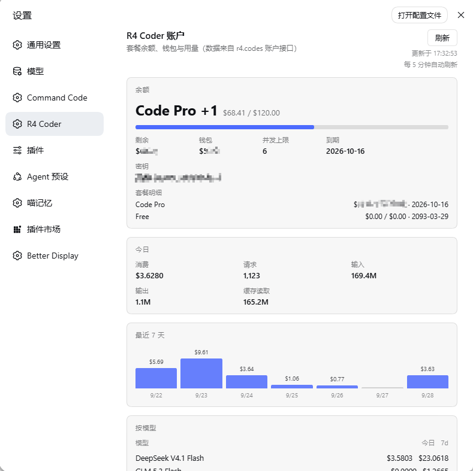

# R4 Coder Account (dsh-r4-coder-account)

非官方 DeepSeek Harness 插件：在 **设置 → R4 Coder** 里显示 [R4 Coder](https://r4.codes)（`r4.codes`）账户的**套餐余额、钱包、并发上限、到期时间、今日消费与最近 7 天用量**。

界面与 `@mars-sea/dsh-commandcode-provider` 的设置页同一形态：一个独立的 `settings.section` 页面，卡片式布局。

## 界面预览



## 数据来源

插件不猜、不抓网页，用的是 R4 Coder 自己 CLI（`r4 usage` / `r4 status`）所依赖的两个账户接口：

| 接口 | 内容 |
|---|---|
| `GET {baseURL}/v1/cli/meta` | 套餐名、剩余/总额、钱包余额、并发上限、到期时间、多笔拨款（grants）、密钥名 |
| `GET {baseURL}/v1/cli/usage?tz=<zone>` | 今日消费/请求数/tokens、最近 7 天日度序列、按模型明细 |

两者都用 `Authorization: Bearer <coder_…>` 认证。

**密钥不经过浏览器**：浏览器只请求本插件在 Host 上注册的 `GET /r4-coder/account`，由 Host 侧解析凭据、调用 R4 API、把 JSON 交回页面。

## 安装

```sh
dsh plugin --profile web add "<本目录路径>"
```

安装后重启 dsh（或依赖 profile 的 live patch reload 生效），在 **设置 → R4 Coder** 即可看到卡片。

## 配置

`$DSH_HOME/profiles/web/cordis.patch.yml` 中该插件行的 `config:`（全部可省略）：

```yaml
- id: r4-coder-account
  name: "dsh-r4-coder-account"
  config:
    apiKeyEnv: R4_CODES_API_KEY        # 凭据引用名
    baseURL: https://api.r4.codes      # R4 Coder API 根
    timeoutMs: 15000                   # 单次查询超时
```

### 密钥从哪来

按顺序解析，先命中者胜：

1. harness 凭据服务里的 `apiKeyEnv`（即 `$DSH_HOME/.credentials.yaml` 的 `refs`，或在 **设置 → Models** 里保存的值）
2. 同名进程环境变量
3. `R4_API_KEY` 环境变量

都没有时，页面会显示“未找到 API 密钥”并提示该保存到哪里，而不是静默空白。

> 本插件默认引用 `R4_CODES_API_KEY` —— 与配套的 `llm-pi-ai` 提供方路由 `r4-codes` 用的是同一个引用名。

## 界面

- **余额**：套餐名、剩余/总额（带进度条）、钱包余额、并发上限、到期日、密钥名；多笔拨款时逐条列出。
- **今日**：消费（USD）、请求数、输入/输出 tokens、缓存读取。
- **最近 7 天**：按自然日（`tz` 取浏览器时区）的消费柱状图，悬停显示当天消费与请求数。
- **按模型**：今日与 7 天消费排名。
- 右上角手动刷新；页面每 5 分钟自动刷新一次。

## 实现说明

- `lib/index.js`（Host）：**零 import**。本地包经 pnpm 以 `file:` 链接安装后，任何 `node_modules` import 都要从源码目录解析，保持无依赖才能让「dsh plugin add / 直接拷贝」两种装法行为一致。它只做一件事：注册 `/r4-coder/account`。
- `lib/client.js`（浏览器）：按 dsh 客户端模块格式（`window.__ModuleLoader__.load`）打包，只用 `require('react')`，注册一个 `settings.section`。
- 密钥引用在运行时是普通字符串（`credentialRef` 即 `brandString` 恒等函数），因此 Host 端无需 import 凭据包即可解析。

### 两个必须遵守的约束（都踩过）

1. **`__ModuleLoader__.load` 的 `id` 必须等于包名**（这里是 `dsh-r4-coder-account`）。
   dsh 的客户端模块系统按清单里的 id 查找注册：写成别的名字（例如 `r4-coder-account`）会让**整个客户端 bundle** 加载失败，GUI 直接显示 “Failed to load plugins / loaded without registering …”，看起来像 dsh 崩了。不是只坏这一个插件。

2. **pnpm 对 `file:` 依赖是拷贝，不是软链**。
   改完本目录的源码后，profile 的 `node_modules/dsh-r4-coder-account` 不会自动更新，必须重新同步：

   ```sh
   cd "$DSH_HOME/profiles/web" && pnpm install
   ```

   验证同步是否生效（两份文件哈希应一致）：

   ```sh
   node -e "const{createHash}=require('crypto');const fs=require('fs');const f=p=>createHash('sha256').update(fs.readFileSync(p)).digest('hex');console.log(f('lib/client.js')===f(process.env.DSH_HOME+'/profiles/web/node_modules/dsh-r4-coder-account/lib/client.js'))"
   ```

## 验证

两个离线测试脚本（不需要启动 dsh，不需要 API key 就能跑客户端那一个）：

```sh
node test-host.mjs     # 用假 ctx 注册路由并真的调用 /r4-coder/account，打印真实账户 JSON
node test-client.mjs   # 用假 __ModuleLoader__ + stub react 渲染页面，检查 ready/loading/缺密钥/上游报错四个分支
```

端到端验证建议开一个**临时实例**，别动正在用的那个：

```sh
dsh --profile web --patch ./port-overlay.yml     # 覆盖 webserver 端口后再启动
```

## 已知限制

- 数据来自 R4 的 CLI 接口，属非公开契约；上游若调整 `/v1/cli/*`，卡片会显示错误而不是崩溃（错误会原样呈现 HTTP 状态与消息）。
- 用量按自然日切分，`tz` 取浏览器时区；跨时区查看同一天的数字会不同。
- 仅展示，不提供购买/充值入口。

## License

MIT
